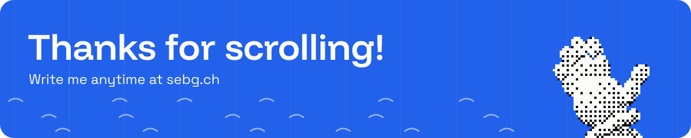

<a href="https://sebg.ch">
  
</a>

### Hey, I'm Seb 👋

Frontend developer at [Liip](https://www.liip.ch/en) in Switzerland. By day I make websites move for Jaeger-LeCoultre, IWC, Piaget and TL. By night I build a menu bar for macOS (yes, like the one up there).

[](https://sebg.ch)
[](https://stablebar.app)
[](https://github.com/Seb-GRAF?tab=repositories&sort=stargazers)

## Things I'm building

<table>
  <tr>
    <td width="50%" valign="top">
      <a href="https://github.com/Seb-GRAF/StableBar"></a>
      <h3><a href="https://github.com/Seb-GRAF/StableBar">StableBar</a> <a href="https://github.com/Seb-GRAF/StableBar/stargazers"></a></h3>
      A native menu bar for macOS with themes, widgets, popups and AeroSpace, yabai or OmniWM workspaces. Built with Swift and SwiftUI.
      <br><br>
      <code>brew install --cask seb-graf/tap/stablebar</code>
    </td>
    <td width="50%" valign="top">
      <a href="https://github.com/Seb-GRAF/tensile"></a>
      <h3><a href="https://github.com/Seb-GRAF/tensile">Tensile</a> <a href="https://www.npmjs.com/package/tensile"></a></h3>
      React components where each control is one shape that moves with its state. Drags keep their speed when you let go.
      <br><br>
      <code>npm install tensile</code>
    </td>
  </tr>
</table>

## `~/.config/seb.json`

```json
{
  "name": "Sebastien Graf",
  "role": "Frontend developer at Liip",
  "location": "Switzerland",
  "builds": "websites that move",
  "worked_on": ["Jaeger-LeCoultre", "IWC", "Piaget", "TL"],
  "side_quest": "StableBar",
  "now_playing": "lo-fi beats to ship to",
  "coffee_today": 3,
  "status": "shipping"
}
```

<sub>StableBar turns any script that prints JSON into a widget, so this file could run the menu bar up top. [Make one →](https://github.com/Seb-GRAF/StableBar/blob/main/docs/create-a-widget.md)</sub>

## Toolbox

<a href="https://github.com/Seb-GRAF?tab=repositories">
  
</a>

## Snack time

A snake eats my contribution graph every day. It never runs out of food.

<picture>
  <source media="(prefers-color-scheme: dark)" srcset="https://raw.githubusercontent.com/Seb-GRAF/Seb-GRAF/output/snake-dark.svg">
  
</picture>

<br><br>

<a href="https://sebg.ch">
  
</a>
